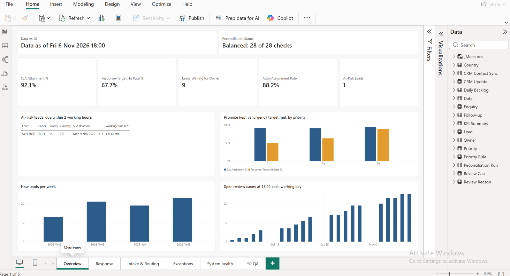
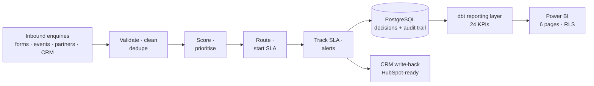
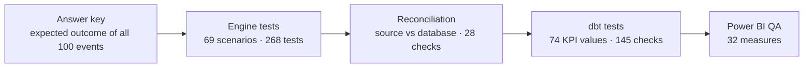

# LeadFlow EU

**Inbound lead routing with a response promise you can measure.** LeadFlow validates every
inbound enquiry, decides how urgent it is, gives it to the right salesperson, tracks whether
they answered in time, keeps the CRM up to date, and reports it all on a tested Power BI
dashboard.

Built end to end as a portfolio project for a simulated B2B research-technology vendor
(**MoP Cloud**) selling in Spain, Portugal and France.

> All company and contact data is synthetic. No real customer information is used.



## In one minute

| | |
|---|---|
| **The problem** | Leads arrive with messy data and wait for someone to route them by hand. Nobody can say how fast leads are answered, so slow follow-up stays invisible and leads go cold. |
| **What LeadFlow does** | Checks and cleans each enquiry, scores fit and interest, sets a priority (P1–P3), assigns an owner by country rotation, starts an 8-working-hour response promise, alerts on misses and absences, writes the outcome back to the CRM, and reports it. |
| **Why it can be trusted** | Every decision is rule-based, versioned and stored with its reasons. Results are checked against a hand-reviewed answer key at every layer: engine, database, reporting model and dashboard. |
| **What it shows (test data)** | 92.1% of leads answered within 8 working hours, but only 67.7% within their urgency target, and the most urgent (P1) leads miss their 1-hour target most often. That is the gap a Sales Manager can act on. |
| **Built with** | Python, PostgreSQL, dbt, Power BI (DAX, row-level security), pytest; HubSpot-ready CRM write-back |

## The business problem

A sales team that answers leads late loses them, and a team that cannot *measure* how late
cannot fix it. In this scenario:

- Enquiries arrive from web forms, events, partners and outbound, with missing countries,
  invalid emails, duplicates, and suppliers or survey participants mixed in with buyers.
- Leads are routed by hand, so some wait for hours and urgent requests are treated like the rest.
- The CRM, the routing and the reports disagree, so meetings start with "whose number is right?"

**Who it serves:** the Sales Manager (coaching, capacity, the review queue), salespeople
(what to call now), RevOps (rules, data quality, system health) and the CRO (is lead
response healthy, at a glance).

## What LeadFlow does

1. **Validate and clean** each enquiry: normalise emails and countries, detect repeats,
   recognise returning contacts, keep suppliers and survey participants out of buyer scoring.
2. **Score and prioritise**: company fit and recent interest set a priority (P1 urgent, P2,
   P3) by one of six named rules, each recorded with its reason codes.
3. **Route**: round-robin by country among available salespeople, keeping a company with its
   existing owner; anything unclear goes to a review queue with the person who must act.
4. **Promise and track**: one response promise of 8 working hours for every assigned lead,
   plus a stricter priority target (1 / 4 / 8 hours). Breaches, late-logged calls, absences
   and reassignments are handled and audited.
5. **Write back to the CRM**: owner, priority, deadlines and status on the contact; only
   changes are sent; retries and failures are handled safely (simulated in this version).
6. **Report**: a dbt reporting layer defines 24 KPIs once; a six-page Power BI dashboard shows
   them, with row-level security so salespeople see only their own leads.

## Architecture



Each layer has its own quality gate, so a mistake is caught where it is made:



More detail, including what each component owns and why: [docs/architecture.md](docs/architecture.md).

## How I know it works

Every claim below has its evidence in the repository.

| Check | What it proves | Result | Evidence |
|---|---|---|---|
| Hand-reviewed scenarios | Each business rule behaves as agreed, including edge cases (weekends, the clock change, absences, late logging) | 69 scenarios, all pass | [test_scenarios.md](docs/test_scenarios.md) |
| Engine and database tests | Decisions, restarts, SLA tracking and CRM write-back are correct and repeatable | 268 tests pass | `tests/`, [test runs](docs/evidence/) |
| Reconciliation | Nothing lost or doubled between the source and the database; every lead, SLA, case and CRM update consistent | 28 of 28 checks balanced | [latest report](docs/evidence/reconciliation_2026-10-29_191208.md) |
| KPI answer-key test | Every KPI equals a value worked out independently from the answer key | 74 values match; `dbt build` 145 of 145 | [reporting_model.md](docs/reporting_model.md) |
| Dashboard QA | Every dashboard measure equals the tested KPI layer | 32 of 32 match | [QA page](docs/evidence/lf012/06_qa.png) |
| Row-level security | A salesperson sees only their own leads | ES-01: 12 leads, team: 76 | [RLS view](docs/evidence/lf012/07_rls_es01.png) |

Deliberately broken versions (a wrong rule, a missed retry, a changed KPI definition) were
used to confirm that the tests fail when they should.

## Results on the test data

100 synthetic enquiries over four weeks (12 Oct – 6 Nov 2026), measured at Friday 6 Nov 18:00.
These numbers show that the system works and what it reveals, not how a real team performs.

| Headline KPI | Value | What a Sales Manager does with it |
|---|---|---|
| SLA attainment | 58 of 63, **92.1%** | Coach on the 5 breaches (listed on the Response page) |
| Response-target hit rate | 44 of 65, **67.7%** | P1 leads miss most: route them to whoever is free, alert at 30 minutes |
| Leads waiting for an owner | **9** | Clear the review queue; most have an unclear or unsupported country |
| Auto-assignment rate | 67 of 76, **88.2%** | A drop would mean a rule or data problem |
| At-risk leads | **1** | The salesperson calls it first thing |

KPI definitions: [kpi_definitions.md](docs/kpi_definitions.md). Dashboard guide:
[dashboard_guide.md](docs/dashboard_guide.md).

## Key design decisions

| Decision | Why |
|---|---|
| Rules, not machine learning, for priority and routing | Sales managers must be able to explain every decision; there is no outcome data to train on. The rules are versioned (`LF-RULES-v1.0`) and every decision stores its reasons |
| One promise (8 working hours) plus a priority target | A single, fair promise for every lead; urgency is measured separately, so the dashboard shows where urgent leads are slowed down |
| Working time everywhere (Mon–Fri 09:00–18:00 Madrid) | A lead received Friday 17:55 is 5 minutes old on Monday 09:00, not 63 hours |
| Unclear cases go to people, never guessed | Wrong country, possible supplier, identity doubts: a review case with the person who must act |
| Every step auditable and safe to rerun | Repeated events are ignored, restarts rebuild state from the database, CRM updates are never sent twice |
| One definition per KPI, tested | dbt defines each KPI once; Power BI reuses it and proves equality |
| No personal data in reports | The dashboard uses references (`SYN-L001`, `RC-…`), not names or emails; Power BI reads through a read-only login |

## Scope and what comes next

- **Not included, on purpose:** conversion, pipeline and revenue (LeadFlow's data stops at the
  first follow-up, and the data is invented), lead-score accuracy (needs real outcomes),
  salesperson league tables.
- **Next:** live HubSpot write-back (LF-010 Phase B), public and regional holiday calendars per
  salesperson (LF-014).

## Repository guide

```
leadflow/                   Python engine + PostgreSQL recording
leadflow/rules/             Versioned business rules (LF-RULES-v1.0.json)
SQL/NNN_*.sql               Schema (001) and migrations (002 to 006), applied in number order
SQL/tests/, SQL/reconciliation/   Constraint tests; database consistency checks
SQL/admin/                  One-off server set-up (read-only Power BI login)
tests/                      pytest: unit, scenario, answer-key and PostgreSQL integration tests
tools/                      Synthetic data generator, reconciliation report, expected KPIs
data/synthetic/             The 100-event dataset and its expected outcomes
reporting/                  dbt project: staging, star schema, KPI summary and tests
reporting/powerbi/          Power BI project (.pbip): model, measures, roles and pages as text
docs/                       Design, rules, engine notes, KPIs, dashboard guide, evidence
```

| Document | Contents |
|---|---|
| [architecture.md](docs/architecture.md) | Components, data flow, quality gates |
| [database_design.md](docs/database_design.md), [data_dictionary.md](docs/data_dictionary.md) | PostgreSQL schema and every field |
| [test_scenarios.md](docs/test_scenarios.md), [synthetic_dataset.md](docs/synthetic_dataset.md) | Reviewed scenarios; the test dataset |
| [engine_lf006.md](docs/engine_lf006.md) … [engine_lf010.md](docs/engine_lf010.md) | Engine: validation, routing, restart, SLA, CRM write-back |
| [crm_field_mapping.md](docs/crm_field_mapping.md) | What LeadFlow writes on each CRM contact |
| [reporting_model.md](docs/reporting_model.md), [kpi_definitions.md](docs/kpi_definitions.md) | dbt reporting layer and the 24 KPIs |
| [dashboard_guide.md](docs/dashboard_guide.md) | Power BI set-up, pages, security |
| [pitch.md](docs/pitch.md), [interview_prep.md](docs/interview_prep.md) | The 3-minute pitch; interview questions and answers |

## Run it locally

Requires PostgreSQL (tested on 18.1) and Python 3.10+.

```bash
python -m venv .venv
source .venv/bin/activate
pip install -r requirements.txt
createdb leadflow_eu_test
export LEADFLOW_TEST_DSN="dbname=leadflow_eu_test user=postgres"
python -m pytest                                              # 268 tests
python tools/reconcile.py --dsn "$LEADFLOW_TEST_DSN" --run    # process the dataset, 28 checks
cd reporting && dbt build                                     # reporting layer, 145 checks
```

dbt reads its connection from `~/.dbt/profiles.yml` (format in `reporting/profiles.example.yml`).
The PostgreSQL tests and `reconcile.py --run` wipe `leadflow_eu_test` and refuse any other
database. Constraint tests: `SQL/tests/run_all_tests.sh --rebuild`. Power BI set-up:
[dashboard_guide.md](docs/dashboard_guide.md).

## Project history

Built card by card (LF-001 to LF-012), each merged as a pull request with its evidence:
scope and rules (LF-001, LF-002), database (LF-003), scenarios and dataset (LF-004, LF-005),
engine (LF-006 to LF-010), reporting (LF-011) and dashboard (LF-012).

## Licence

[MIT](LICENSE). The data is synthetic; MoP Cloud and every person and company in it are fictional.
