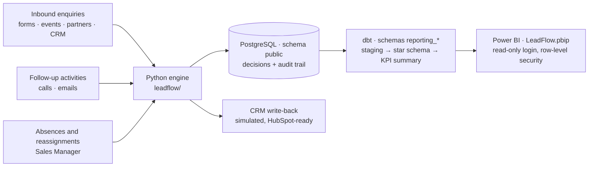
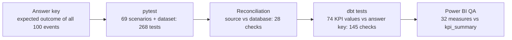

# Architecture

LeadFlow EU separates **deciding** (the Python engine), **remembering** (PostgreSQL),
**telling the CRM** (the write-back) and **reporting** (dbt and Power BI). Each layer has its
own quality gate, so a mistake is caught where it is made, not discovered on a dashboard.

## Data flow

## Components

| Layer | Where | Owns | Does not do |
|---|---|---|---|
| Rules | `leadflow/rules/LF-RULES-v1.0.json` | Scoring weights, priority rules, SLA and targets, review routing, working hours. Versioned; every decision records the version | Logic: the engine reads them |
| Engine | `leadflow/` (Python) | Validation and normalisation, identity (new, returning, ambiguous), fit and engagement scores, priority, routing (country round-robin, same-company owner), SLA start and tracking, alerts, reassignment | Reporting; it never reads its own output for KPIs |
| Storage | `SQL/` (PostgreSQL, migrations 001–006) | Every event, decision (with inputs and reasons), assignment, SLA and its history, review case and action, follow-up, CRM attempt. Constraints enforce the integrity rules | Business decisions |
| CRM write-back | `leadflow/crm.py` | Intended contact values (a view), diff against what the CRM confirmed, one logged attempt at a time, retries and back-off, read-back after a timeout, RevOps case after giving up | Contact master data: the CRM keeps names and emails |
| Reporting | `reporting/` (dbt) | Staging views, star schema (8 facts, 6 dimensions), 24 KPIs defined once in `kpi_summary`, working-time function | Decisions; it only reads `public` |
| Dashboard | `reporting/powerbi/` | 46 measures mirroring the KPIs, six pages, row-level security | KPI logic of its own: a QA measure proves it equals `kpi_summary` |

## Quality gates

| Gate | Catches |
|---|---|
| Scenario and answer-key tests | A rule implemented differently from what was agreed |
| Restart tests | State lost or duplicated when the engine stops and resumes |
| Constraint tests (`SQL/tests/`) | Data that breaks the integrity rules, even if written by another tool |
| Reconciliation (`tools/reconcile.py`) | Events lost or doubled; inconsistent leads, SLAs, cases, CRM updates. Every run is recorded and shown on the dashboard |
| dbt tests | A KPI that drifts from its definition; facts that lose or double rows |
| Power BI QA measure | A dashboard measure that differs from the tested layer |

## Design principles

- **Explainable before clever.** Rules, not models, decide priority and routing; every
  decision stores its inputs, scores and reason codes.
- **Safe to rerun.** Events are idempotent on `(source_system, source_event_id)`; the engine
  rebuilds its memory from the database after a restart; CRM updates are confirmed once.
- **People decide the unclear cases.** Missing or conflicting countries, possible suppliers,
  identity doubts and absences open review cases for the person who must act; nothing is guessed.
- **Measured in working time.** SLA, targets, ages and waits count Monday to Friday,
  09:00–18:00 Madrid, the same in Python and SQL (tested on thousands of pairs of moments).
- **Least privilege, no personal data in reports.** Power BI reads only the `reporting`
  schema through a read-only login; reports use references, not names or emails.
- **One definition per number.** A KPI is written once (dbt) and proven equal everywhere it
  is shown.

## Scaling notes

The MVP runs on one PostgreSQL database with 100 synthetic events. For production volumes:
events would arrive through a queue or CRM webhooks instead of a batch file; the reporting
layer would move to a warehouse (Snowflake or BigQuery) with incremental dbt models; the CRM
write-back would use the HubSpot API with its documented rate limits (LF-010 Phase B); and
Power BI would refresh on a schedule through a gateway. The rules, the audit trail and the
quality gates stay the same.
